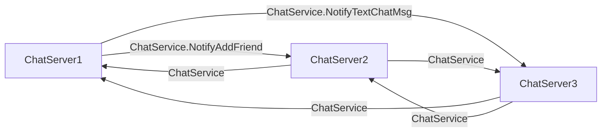
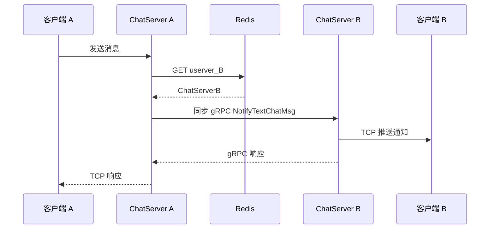
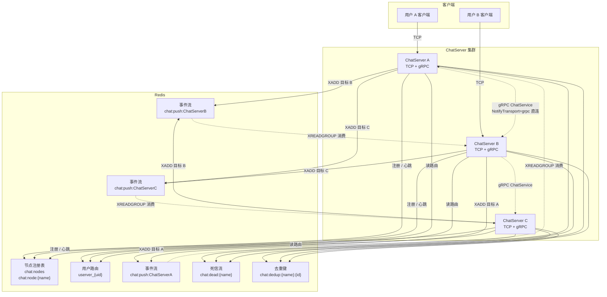
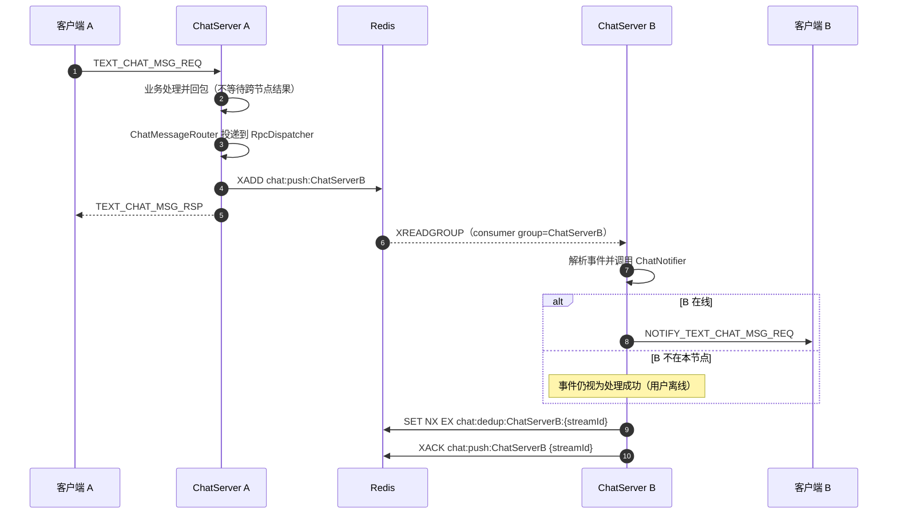
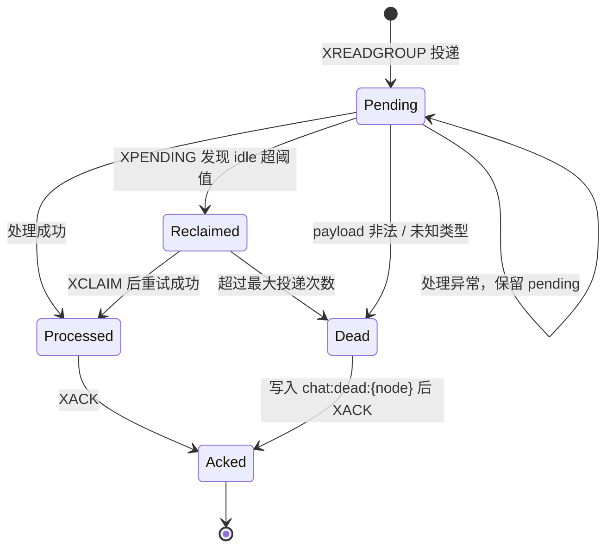
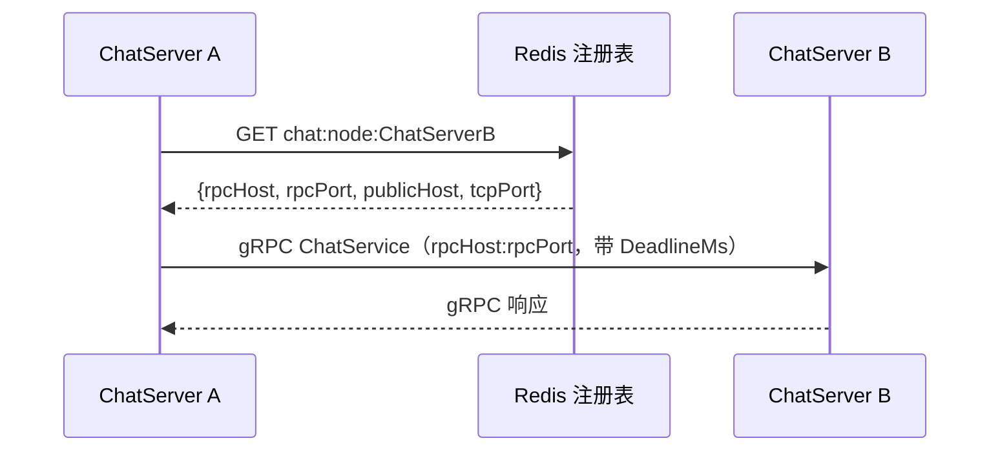

# 多 ChatServer 通信改造说明

## 1. 背景与目标

聊天节点是水平扩展的：用户登录后由 StatusServer 分配到一个 ChatServer，用户 A 与用户 B 可能在不同节点。好友申请、好友认证结果、文本消息、顶号踢下线等事件需要从 A 所在节点送到 B 所在节点。

改造前的跨节点通信以“节点间直连 gRPC”为主：每个 ChatServer 需要知道其他节点的地址，通知在业务线程或派发线程里同步调用对端 `ChatService`。节点数量和配置项随实例数增长，可靠性与可观测性也依赖每个调用点的实现。

本文对比改造前与最终版本：改造前是静态对端 + 同步 gRPC，最终版本是 Redis 节点注册 + Redis Stream 数据面。升级方式为一次全量升级，不保留新旧版本混跑。

本次改造把“跨节点通知”拆成两层：

- **控制面**：节点注册发现、token 校验、状态查询等需要明确结果的请求继续使用 Redis 注册表 + gRPC。
- **数据面**：好友通知、消息转发、踢下线等异步事件默认写入 Redis Stream，由目标节点消费并落地到本机客户端；gRPC 保留为显式直连通道。

目标如下：

1. 新增 ChatServer 不再需要修改其他节点的对端配置。
2. 节点间通知从同步调用改为异步投递，单个对端变慢或重启不拖住本节点业务线程。
3. 提供至少一次投递、ACK、pending 回收、重试、去重与死信，降低“调用失败即永久丢失”的概率。
4. 保留同步 gRPC 能力，控制面请求和需要直连的场景不被 Stream 改造绑死。

## 2. 改动前：静态对端 + 同步 gRPC

### 2.1 拓扑

改造前每个 ChatServer 的配置中会出现其他节点的地址，形成近似全连接的逻辑拓扑。N 个节点时，需要维护 O(N²) 量级的节点地址条目和连接关系：

```ini
# ChatServer1/config.ini（改造前）
[ChatServer2]
Name = ChatServer2
Host = 10.0.0.12
RPCPort = 50082

[ChatServer3]
Name = ChatServer3
Host = 10.0.0.13
RPCPort = 50083
```

实际发送通知时，业务代码按目标用户名从 Redis 的 `userver_{uid}` 找到目标节点名，再通过 `ChatGrpcClient` 建立到该节点的 gRPC 连接：



### 2.2 调用链



改造前的主要问题：

- **配置复杂度 O(N²)**：新增或迁移节点时，需要同步维护其他节点的对端段；地址变更容易漏改。
- **调用与业务线程耦合**：早期实现直接在 LogicSystem 单业务线程里发起 gRPC，对端卡住会阻塞本节点所有业务消息。
- **超时与重试不完整**：没有统一 deadline 时，故障节点可能长时间占用调用方资源；调用失败通常只记录日志。
- **没有持久化缓冲**：目标节点重启期间的通知直接失败，发送方没有 pending/重试状态。
- **故障语义不清晰**：gRPC 返回成功只代表目标节点接收了请求，不代表目标用户在线，更不代表客户端已经收到。
- **观测困难**：只能从调用方日志逐条排查，缺少“目标节点还有多少未处理事件”的聚合视角。

### 2.3 本次升级的边界

最终版本采用一次性全量升级：所有 ChatServer 同时切换为新版本，不保留新旧版本混跑，也不再读取旧 `[PeerServer]` / `[ChatServerN]` / `[ChatServers]` 静态配置。

`NotifyTransport=grpc` 不是旧版本兼容路径，而是新版本提供的显式直连模式；它同样使用 Redis 注册表中的节点地址。

## 3. 改动后：控制面 gRPC + 数据面 Redis Stream

### 3.1 总体架构



关键点：

- 事件流数量是 **N 条**，不是 N×N 条连接。每个 ChatServer 只拥有并消费自己的 `chat:push:{name}`。
- 任意节点向目标节点发送事件时只需要目标节点名，不需要预先知道其 IP/端口。
- `ChatService` gRPC 服务仍然保留，作为 `NotifyTransport=grpc` 的显式直连路径。它的响应只表示目标节点接收了通知，不表示目标客户端已收到；token 校验、节点分配等需要明确结果的控制面请求仍走 `StatusService` / `VerifyService` 的 gRPC。
- 节点注册表供 gRPC 直连路径解析地址，也供 StatusServer 发现可分配节点。

### 3.2 组件职责

| 组件 | 位置 | 职责 |
|---|---|---|
| `ChatNodeRegistrar` | `common/node_registry` | 启动写 `chat:node:{name}` 并加入 `chat:nodes`，定时续期；退出注销 |
| `ChatMessageRouter` | `ChatServer/chat_message_router` | 所有跨节点通知的统一出口，按配置选择 Stream 或 gRPC |
| `ChatEventBus` | `ChatServer/chat_event_bus` | 序列化 protobuf，`XADD chat:push:{target}`，设置裁剪长度与 TTL |
| `ChatEventConsumer` | `ChatServer/chat_event_consumer` | 建 consumer group、`XREADGROUP`、处理、`XACK`、回收 pending、写死信 |
| `ChatNotifier` | `ChatServer/chat_notifier` | 查本机 `UserManager` 会话并组装 JSON 推送；Stream 与 gRPC 共用 |
| `ChatServiceImpl` | `ChatServer/chat_service_impl` | gRPC 服务端，调用 `ChatNotifier` 落地通知 |
| `ChatGrpcClient` | `ChatServer/chat_grpc_client` | gRPC 直连路径；只从 Redis 注册表解析对端地址 |
| `RpcDispatcher` | `ChatServer/rpc_dispatcher` | 固定 key 落到固定 worker，异步执行 `XADD` 或 gRPC；避免阻塞 LogicSystem |

### 3.3 事件格式

每条 Stream 消息包含以下字段：

| 字段 | 说明 |
|---|---|
| `type` | 事件类型：`AddFriend` / `FriendAccepted` / `TextChatMsg` / `KickUser` |
| `payload` | 对应 protobuf 消息的二进制序列化结果 |
| `source` | 发布节点名，便于排查与死信定位 |
| `event_id` | 发布端生成的事件标识（节点名 + 毫秒时间 + 序号） |
| `created_ms` | 事件创建时间，用于过期判断 |

payload 直接复用 `common/proto/message.proto` 中的现有消息，不再维护第二套 JSON schema；收发两端必须使用兼容的 proto 定义。

### 3.4 正常投递时序



注意：`SA-->>CA` 的响应发生在跨节点事件真正被 B 消费之前，客户端 ACK 只表示本节点业务处理完成。

### 3.5 可靠投递与失败处理

消费者状态机：



具体策略：

- **consumer group**：group 名等于节点名，consumer 名为 `节点名:pid`。同一条消息在同一 group 内只由一个消费者处理。
- **建组位置**：`XGROUP CREATE ... $` 从建组时刻之后的消息开始消费。因此启动顺序是“先建组、再注册节点”；若 Redis 在启动时不可用，consumer 每 1 秒重试建组，注册心跳每 10 秒重试，恢复后应确认 `XINFO GROUPS` 已存在。
- **ACK**：业务处理成功后才 `XACK`；处理抛异常时保留 pending，等待 reclaim。
- **pending 回收**：每 `StreamReclaimIntervalSeconds`（默认 30 秒）执行一次 `XPENDING`，对空闲超过 `StreamPendingMinIdleSeconds`（默认 60 秒）的消息执行 `XCLAIM` 重试。
- **最大投递次数**：超过 `StreamMaxDeliveryAttempts`（默认 5）写入死信流。
- **非法事件**：缺少字段、未知类型、protobuf 解析失败直接进入死信，避免无限重试。
- **过期事件**：`created_ms` 超过 `StreamMaxEventAgeSeconds`（默认 300 秒，0 表示不限制）时丢弃并 ACK，避免节点长时间离线后补发过期消息。
- **幂等去重**：处理成功后写 `chat:dedup:{node}:{streamId}`（默认 TTL 600 秒）。reclaim 重放时先查该键，命中则直接 ACK。
- **裁剪与 TTL**：每条流约保留 `StreamMaxLen`（默认 10 万）条；流和死信流 TTL 默认 86400 秒。节点停机超过该时间，未消费事件会丢失。

### 3.6 顺序、重复与一致性

- **单发布者到单目标节点的顺序**：`ChatMessageRouter` 以目标节点名为 key 投递到 `RpcDispatcher`，同一 key 固定落到同一 worker，因此同一源节点到同一目标节点的发布顺序稳定。
- **全局顺序**：不存在。多个源节点并发 `XADD` 时，Stream 按 Redis 接收顺序追加；不同源节点之间没有业务因果排序。
- **重复投递**：系统是至少一次语义。`XACK` 前崩溃、reclaim 重放、去重键写入前崩溃都可能产生重复；客户端或业务侧应按 `msg_id` 做幂等。
- **不保证在线送达**：目标用户不在线时事件被正常消费并 ACK，相当于“丢弃离线通知”；这与改造前“用户不在线就不推送”的业务语义一致。

### 3.7 新版本中的 gRPC 直连模式

如果某个 ChatServer 确实需要绕过 Stream、直接调用目标节点，仍然可以使用 gRPC，但不需要恢复旧版静态配置：

```ini
[Cluster]
NotifyTransport = grpc
```

调用链如下：



要点：

- 目标节点名仍来自 `userver_{uid}`，地址来自 `chat:node:{name}`，不需要 `[ChatServerN]`。
- 多网卡或 NAT 环境下，由目标节点配置 `[SelfServer] RpcHost` 为**调用方可达**的地址；`PublicHost` 只用于下发给客户端。
- 外部业务服务也可以直接调用 ChatServer 的 `ChatService`，地址为 `RpcHost:RPCPort`；当前没有 gRPC 鉴权，只应部署在内网或可信网络。
- 直连模式不经过 Stream 缓冲，目标节点重启期间的通知仍可能丢失；它适合低延迟场景或 Stream 故障时的显式切换。

## 4. 改动前后对比

| 维度 | 改动前（静态对端 + 同步 gRPC） | 改动后（Redis Stream 数据面） |
|---|---|---|
| 节点配置 | 每个节点维护其他节点地址，O(N²) 条目 | 只配置自身信息；对端通过节点名与 Redis 发现 |
| 拓扑 | 逻辑全连接，N×(N-1) 条调用关系 | N 条事件流，任意节点按目标名发布 |
| 传输方式 | 同步 gRPC 请求-响应 | 异步 `XADD` / consumer group 消费；gRPC 可显式直连 |
| 业务线程 | 早期直接阻塞；后改为派发 worker | 业务 worker 只投递到派发队列，`XADD` 与 gRPC 都在派发 worker 执行 |
| 客户端响应 | 本节点处理完即返回 | 不变，仍由本节点 Handler 立即返回 |
| 投递可靠性 | 调用失败通常只记日志 | 至少一次：ACK、pending、reclaim、死信、去重 |
| 目标节点重启 | 重启窗口内通知失败 | 事件保留在 Stream，恢复后继续消费（TTL 内） |
| 超时控制 | 依赖 gRPC deadline | 主要靠 Stream TTL/积压治理；gRPC 直连仍使用 `DeadlineMs` |
| 顺序 | 单连接调用顺序较直观 | 单源到单目标有序；跨源无全局顺序 |
| 重复消息 | gRPC 通常不重试，重复少但可能丢 | 至少一次，可能重复，需要 `msg_id` 幂等 |
| 运维观测 | 主要看调用方日志 | `XLEN` / `XINFO GROUPS` / `XPENDING` / 死信流 |
| 外部依赖 | Redis（路由/注册）+ 对端 gRPC | Redis 成为跨节点通知的强依赖；gRPC 仅用于显式直连 |
| 扩缩容 | 新节点需要通知所有节点改配置（早期） | 新节点自行注册即可；其他节点无需改配置 |
| 升级方式 | 各节点可独立升级，依赖 gRPC 协议兼容 | 一次全量升级到新版本，不支持新旧版本混跑 |

## 5. 优缺点

### 5.1 优点

1. **配置复杂度从 O(N²) 降到 O(N)**：节点只关心自身配置，对端地址由注册表或目标节点名决定。
2. **故障隔离更好**：目标节点慢、重启或网络抖动时，发布方只承担一次 `XADD` 的开销，不会长时间阻塞业务线程。
3. **具备缓冲能力**：目标节点短暂不可用时，事件保留在 Stream 中，恢复后可继续消费。
4. **可靠性可运营**：pending、投递次数、死信、去重键都能通过 Redis 命令观察和处理。
5. **复用现有基础设施**：项目已经依赖 Redis，不额外引入 Kafka/RabbitMQ 等中间件。
6. **统一落地逻辑**：Stream 消费和 gRPC 服务端都调用 `ChatNotifier`，避免两条链路的 JSON 字段或错误码漂移。
7. **直连模式切换简单**：`NotifyTransport=stream|grpc` 单开关切换，不需要恢复旧静态配置。

### 5.2 代价与风险

1. **Redis 成为数据面强依赖**：Redis 不可用时 Stream 发布失败；虽然可以切到 gRPC 直连，但节点发现和路由本身也依赖 Redis。
2. **至少一次而非恰好一次**：重复投递需要业务幂等；去重键只覆盖 reclaim 重放，不能消除“处理成功但去重键未写入”的崩溃窗口。
3. **发布失败没有本地 outbox**：当前 `Publish` 失败只记录错误日志，不进入本地重试队列；极端情况下仍可能丢事件。
4. **无全局顺序**：跨源事件没有统一排序，不能依赖 Stream 实现全局因果一致。
5. **离线/过期丢弃**：节点停机超过 TTL，或事件超过最大存活时间，会被裁剪或丢弃；这不是持久化消息队列。
6. **单流热点**：单个目标节点的所有来源写入同一条 Stream，热点节点的事件量受 Redis 单 key 吞吐限制；当前规模可用，超大集群需要分片。
7. **运维复杂度上升**：需要监控 lag、pending、死信和流长度；错误配置（如 TTL 过短）会静默丢消息。
8. **升级约束**：必须一次全量升级，不支持新旧版本混跑；全量升级完成后所有节点都能消费各自的 Stream。

## 6. “同步响应”怎么理解

改造后仍然保留同步响应，但需要区分三种“成功”：

| 层次 | 含义 | 当前实现 |
|---|---|---|
| 客户端请求响应 | 本节点已完成鉴权、落库/业务判定并回包 | Handler 立即返回，不等待跨节点投递 |
| 事件发布成功 | 事件已写入目标节点的 Redis Stream | `XADD` 返回非空 ID；异步执行 |
| 目标客户端送达 | 目标节点找到会话并写入 TCP 发送队列 | 消费端处理，成功与否不影响发送方响应 |

因此：

- 对好友申请、文本消息、踢下线等**通知型**操作，Stream 的异步语义是合适的；发送方不需要等待目标客户端确认。
- 对需要明确结果的控制面调用（例如 token 校验、节点分配、未来的强一致业务），继续走 gRPC 请求-响应。
- 如果未来确实需要“跨节点强同步”，可以在 gRPC 上增加业务 ACK，或实现 Stream 请求-响应（请求事件携带 reply stream/请求 ID，响应写回调用方流）。当前没有实现，文档不把 Stream 描述成同步 RPC 的替代品。

## 7. 全量升级与直连模式

### 7.1 配置

```ini
[Cluster]
NotifyTransport = stream   # 默认；grpc 为显式直连模式
```

`ChatMessageRouter` 在进程启动时读取该配置，修改后需要重启 ChatServer 生效。

### 7.2 全量升级步骤

1. 停止所有 ChatServer 与 StatusServer，确保升级期间没有旧版本节点继续提供服务。
2. 部署新版本二进制和配置；每个 ChatServer 只需保留 `[SelfServer]`，删除旧的 `[PeerServer]` / `[ChatServerN]` 对端段。
3. 按 `Redis → VerifyServer → GateServer → ChatServer 全部实例 → StatusServer` 的顺序启动。
4. 确认每个 ChatServer 已注册并建立消费组：

```bash
redis-cli SMEMBERS chat:nodes
redis-cli XINFO GROUPS chat:push:ChatServer1
```

5. 做一次跨节点好友申请 / 文本消息冒烟，确认目标节点日志出现 `ChatEventConsumer` 消费记录。

升级完成后所有节点都是新版本，不存在“新节点发给旧节点”的兼容问题。

### 7.3 切换到 gRPC 直连

如果某个节点需要低延迟直连，设置：

```ini
[Cluster]
NotifyTransport = grpc
```

并重启该节点。地址仍从 `chat:node:{name}` 读取 `RpcHost:RPCPort`，不需要恢复任何静态对端配置。多网卡/NAT 场景由目标节点调整 `RpcHost`。

直连模式不经过 Stream 的缓冲和重试；如果需要重新使用 Stream，把配置改回 `stream` 并重启即可。切换前未消费的 `chat:push:*` 事件不会自动通过 gRPC 补发，需要人工评估是否重放。

## 8. 运维与排障

### 8.1 常用命令

```bash
# 当前存活节点
redis-cli SMEMBERS chat:nodes
redis-cli GET chat:node:ChatServer1

# 流长度与消费组状态（lag / pending / consumers）
redis-cli XLEN chat:push:ChatServer1
redis-cli XINFO GROUPS chat:push:ChatServer1
redis-cli XINFO CONSUMERS chat:push:ChatServer1 ChatServer1

# 查看 pending 明细（id / consumer / idle / delivery count）
redis-cli XPENDING chat:push:ChatServer1 ChatServer1 - + 20

# 查看死信
redis-cli XLEN chat:dead:ChatServer1
redis-cli XRANGE chat:dead:ChatServer1 - + COUNT 10

# 查看事件内容（payload 是 protobuf 二进制，主要看 type/source/created_ms）
redis-cli XRANGE chat:push:ChatServer1 - + COUNT 5
```

### 8.2 关键配置

| 配置 | 默认值 | 作用 |
|---|---|---|
| `[Cluster] NotifyTransport` | `stream` | `stream` 使用 Redis Stream；`grpc` 使用显式直连 |
| `NodeTTLSeconds` | 30 | 节点注册键 TTL |
| `HeartbeatSeconds` | 10 | 节点注册心跳间隔 |
| `StreamMaxLen` | 100000 | 单条事件流的近似最大长度 |
| `StreamKeyTtlSeconds` | 86400 | 事件流与死信流 TTL |
| `StreamBatchSize` | 64 | 单次 `XREADGROUP` / reclaim 批量 |
| `StreamBlockMs` | 1000 | `XREADGROUP BLOCK` 时间 |
| `StreamReclaimIntervalSeconds` | 30 | pending 回收周期 |
| `StreamPendingMinIdleSeconds` | 60 | pending 最小空闲时间，超过才 reclaim |
| `StreamMaxDeliveryAttempts` | 5 | 最大投递次数，超过写死信 |
| `StreamMaxEventAgeSeconds` | 300 | 事件最大存活时间，0 表示不限制 |
| `DedupTtlSeconds` | 600 | 消费幂等键 TTL |
| `[Redis] BlockingSocketTimeoutMs` | 5000 | 阻塞读专用连接的 socket 超时 |
| `[RPC] DeadlineMs` | 500 | gRPC 直连路径的超时 |
| `[RPC] WorkerThreads` | 2 | 派发 worker 数 |
| `[RPC] MaxPendingPerWorker` | 4096 | 每个 worker 的队列上限，满队列丢弃并记日志 |
| `[Business] WorkerThreads` | 4 | 业务 worker 数；同一 session 固定同一 worker |
| `[Business] MaxPendingPerWorker` | 4096 | 每个业务 worker 的队列上限，满队列关闭连接 |

### 8.3 常见现象

| 现象 | 可能原因 | 处理 |
|---|---|---|
| `lag` 持续增长 | 消费线程异常、Redis 阻塞连接超时、消费者未启动 | 看 ChatServer 日志中的 `ChatEventConsumer`；检查 `XINFO CONSUMERS` 是否在线 |
| `pending` 持续增长 | 处理逻辑抛异常、目标节点反复重启 | `XPENDING` 看 idle/delivery；异常修复后等待 reclaim，或人工评估重放 |
| 死信增加 | payload 非法、未知事件类型、超过最大投递次数 | `XRANGE chat:dead:{node}` 查看 `reason`；修复版本后按需重放 |
| Stream 不存在 | 节点从未发布过事件，或 TTL 已过期 | 正常现象；consumer 会在下次读取时按需重建 group |
| 跨服通知全部丢失 | 节点未注册、`userver_{uid}` 指向错误节点，或误配了 `NotifyTransport` | 检查 `chat:nodes`、`chat:node:{name}` 与目标节点日志；必要时切 `grpc` 直连排查 |
| 重启后短暂无通知 | 旧的 `userver_{uid}` 指向已下线节点 | 用户重新登录会覆盖路由；节点注册 TTL 最长 30 秒 |

## 9. 当前限制与后续可选演进

当前实现适合“通知型、可容忍秒级延迟、可容忍少量重复”的 IM 场景。以下能力尚未实现，可作为后续演进：

1. **本地 outbox**：`XADD` 失败时落本地磁盘/数据库，后台重试，进一步降低 Redis 抖动导致的丢事件。
2. **请求-响应事件**：为需要跨节点确认的业务增加 reply stream 与超时控制，替代部分同步 gRPC。
3. **按目标分片**：热点节点拆成多条 Stream（如按 uid hash），提升 Redis 单 key 吞吐。
4. **业务级幂等**：消费端按 `msg_id` 或业务唯一键去重，补足 Stream ID 去重无法覆盖的业务重复。
5. **可观测性指标**：把 `XLEN`、`lag`、`pending`、死信数量导出为 Prometheus 指标，接入告警。
6. **死信重放工具**：提供受控的重放命令，而不是人工 `XADD`。

## 10. 代码位置索引

| 文件 | 作用 |
|---|---|
| `ChatServer/src/chat_message_router.{h,cpp}` | 跨节点通知统一出口与 transport 选择 |
| `ChatServer/src/chat_event_bus.{h,cpp}` | Stream 发布、事件 ID、裁剪与 TTL |
| `ChatServer/src/chat_event_consumer.{h,cpp}` | consumer group、消费、ACK、reclaim、死信、去重 |
| `ChatServer/src/chat_notifier.{h,cpp}` | 本机会话查找与客户端 JSON 推送 |
| `ChatServer/src/rpc_dispatcher.{h,cpp}` | 固定 key 的异步派发队列 |
| `ChatServer/src/chat_grpc_client.{h,cpp}` | gRPC 直连通道与节点地址解析 |
| `ChatServer/src/chat_service_impl.{h,cpp}` | gRPC `ChatService` 服务端 |
| `common/include/chat/node_registry.h`、`common/src/node_registry.cpp` | 节点注册、发现、TTL 心跳 |
| `common/include/chat/node_info.h`、`common/src/node_info.cpp` | 节点信息编解码 |
| `common/include/chat/redis_manager.h`、`common/src/redis_manager.cpp` | Stream API 与阻塞连接 |
| `ChatServer/main.cpp` | 启动顺序：gRPC/TCP 就绪 → consumer group → 节点注册；退出反序清理 |
