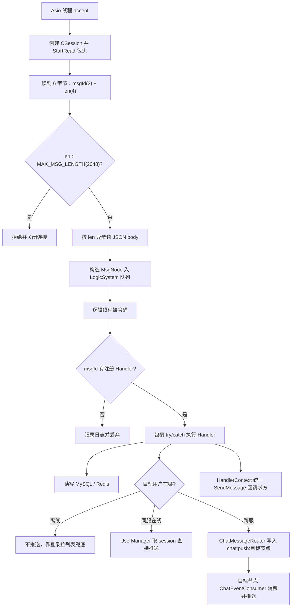
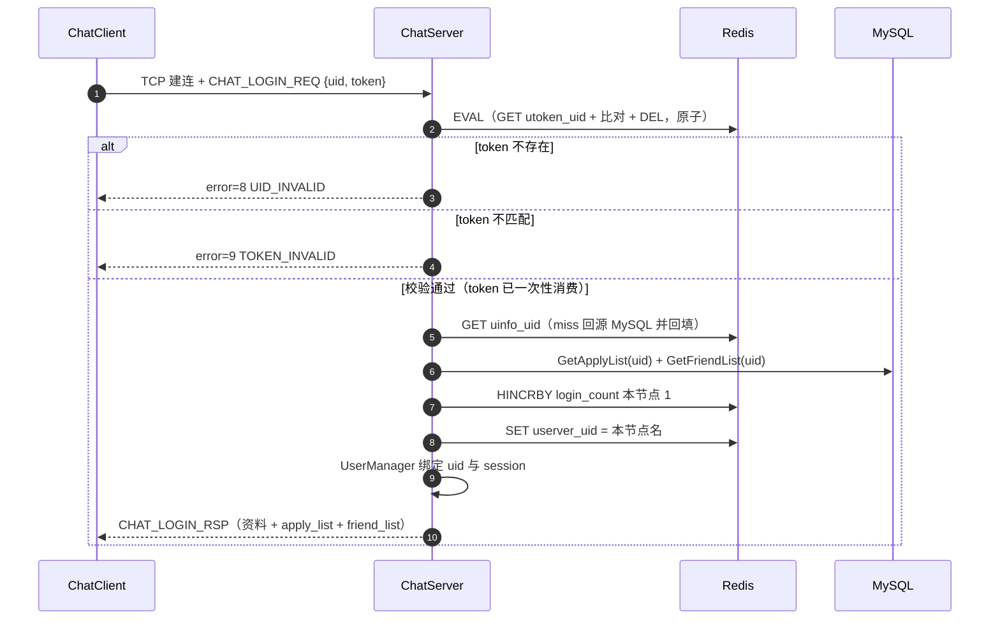
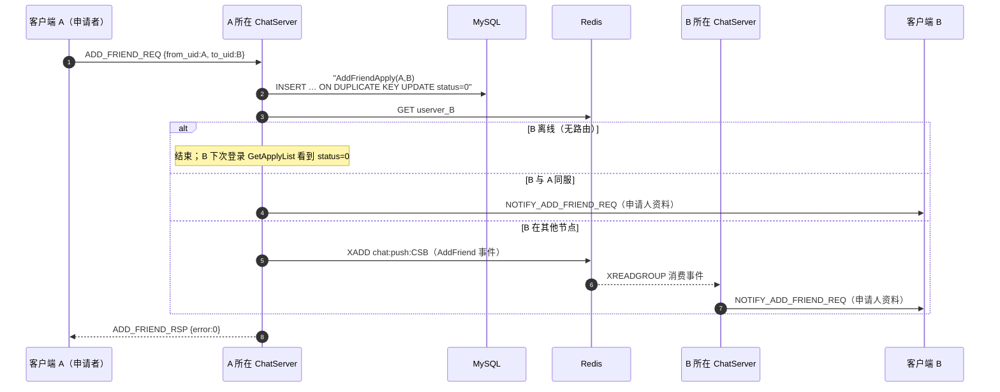
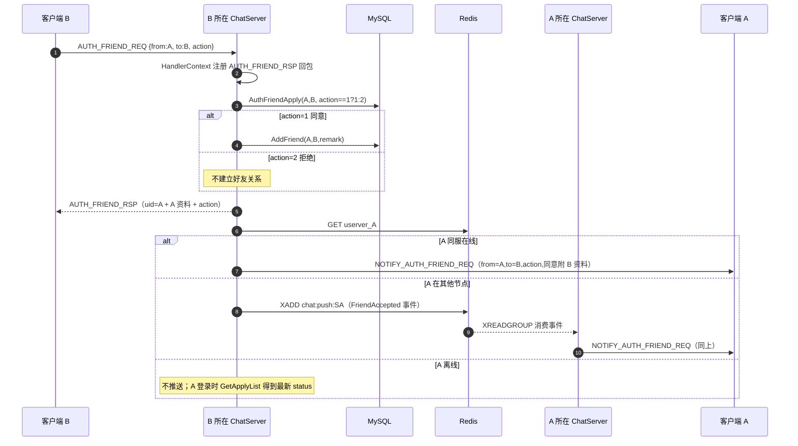
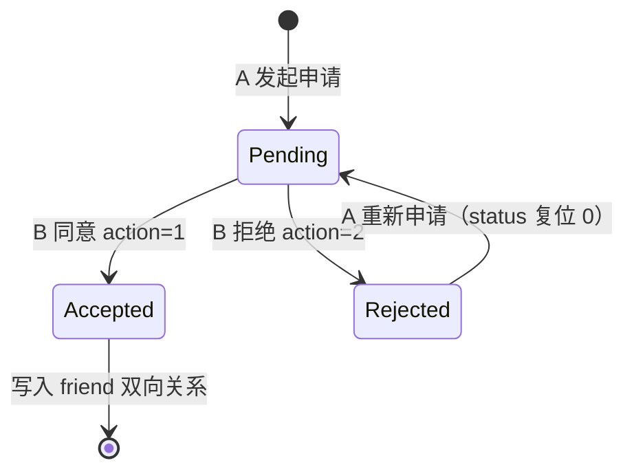
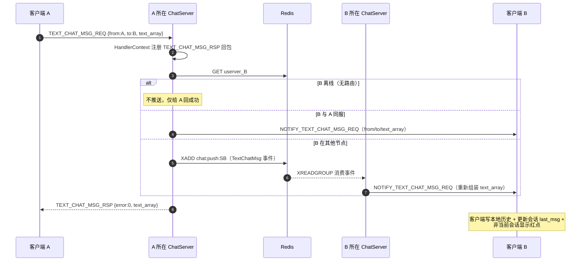

# ChatServer

## 简介

分布式聊天系统的核心聊天节点：负责客户端 TCP 长连接、登录校验、好友关系维护，以及节点间的好友通知与消息转发。跨节点通知默认投递到 Redis Stream（每个节点一条事件流），由消费组异步落地；`ChatService` gRPC 保留为显式直连通道。可部署多实例（`config.ini` / `config2.ini`），由 StatusServer 按 Redis 中的 `login_count` 做最小连接数分配。

> 多节点通信的改造前后对比、完整架构与运维命令见 [../CLUSTER_COMMUNICATION.md](../CLUSTER_COMMUNICATION.md)。

## 核心功能

- **TCP 连接管理**：基于 Boost.Asio 多 io_context 线程池 accept，每个连接一个 `CSession`
- **单线程业务队列**：收包反序列化成 `MsgNode` 投递到 `LogicSystem` 队列，由独立逻辑线程串行处理（业务无锁）
- **登录二次校验**：GateServer 颁发的 token 在 TCP 建连后由 ChatServer 直连 Redis，通过 Lua 原子完成「读取 + 比对 + 删除」，同一 token 只能成功登录一次
- **好友系统**：搜索用户、申请、同意（action=1）/拒绝（action=2）；拒绝后对方重新申请自动复位为待处理
- **文本聊天**：`text_array` 批量承载多条文本（每条带客户端生成的 msg_id），同服直接推 session，跨服写入目标节点的 `chat:push:{node}` Stream
- **可靠的跨节点事件投递**：Redis Stream consumer group + `XACK` + `XPENDING/XCLAIM` 重试 + 去重键 + 死信流，至少一次投递
- **统一回包与异常兜底**：各 Handler 用 `HandlerContext`（RAII 骨架）保证任何分支都回包，单条消息异常不会杀死逻辑线程

## 架构组成

| 模块 | 说明 |
|------|------|
| CServer | TCP 服务器，accept 连接、管理 session 增删（`RemoveSession`，session 通过 `SetRemoveCallback` 反向通知） |
| CSession | 客户端会话：异步读 6 字节包头 → 读 JSON 体 → 投队列；发送队列 + 异步写 |
| MsgCodec | `msg_codec.*`：TCP 帧头编解码（大端）、body 长度上限校验（纯函数，有单测） |
| MsgNode | 收包节点（含 msgId、当前长度、扩容逻辑） |
| LogicSystem | 消息分发骨架：注册 `handleFuncs_`（msgId → Handler），单线程消费队列；Handler 只做解析与回包 |
| ChatFlow | `chat_flow.*`：可单测的纯业务函数（搜人 / 资料加载 / 登录 / 加好友 / 认证 / 文本消息 / 跨节点通知 JSON） |
| UserManager | 内存中 uid → shared_ptr\<CSession\> 映射，用 `common` 的 `SessionRegistry` 模板（互斥保护） |
| ChatNotifier | 跨节点通知的统一落地逻辑：查本机会话并组装 JSON 推给客户端；gRPC 服务端与 Stream 消费者共用 |
| ChatServiceImpl | gRPC 服务端（显式直连通道）：接收其他节点直连通知，落地逻辑复用 `ChatNotifier` |
| ChatGrpcClient | 按需动态发现对端：只读 Redis 节点注册表；每个对端一个 stub 池（每池 5 条），带 deadline。`NotifyTransport=grpc` 时用于显式直连 |
| ChatEventBus | Stream 发布端：`XADD chat:push:{target}`，payload 为 protobuf 二进制，并维护流长度与 TTL |
| ChatEventConsumer | Stream 消费端：consumer group 消费、ACK、pending 回收、幂等去重、过期丢弃与死信写入 |
| ChatMessageRouter | 跨节点通知统一出口：按 `[Cluster] NotifyTransport` 选择 Stream 或 gRPC，两种方式都经 `RpcDispatcher` 异步执行 |
| RpcDispatcher | 把跨节点通知从 LogicSystem 单业务线程移到固定 worker；同一目标节点固定同一 worker，保证本节点到该对端的投递顺序 |

## 内部处理流程



## 消息协议

帧格式（**网络字节序 / 大端**，通过 `htons`/`ntohs`/`htonl`/`ntohl` 转换）：`2 字节 msgId + 4 字节 body 长度 + JSON body`。客户端 Qt 侧对应 `QDataStream::BigEndian`。

> ⚠️ **收发上限不对称**（定义在 `msg_codec.h`）：客户端请求 body 上限 `MAX_MSG_LENGTH = 2048` 字节，超限直接断连；服务端响应 body 上限 `MAX_OUTBOUND_MSG_LENGTH = 1MB`，登录回包中的好友/申请列表可正常下发，但超限同样拒绝发送并关闭连接。
> 客户端发送更长内容必须自行分批。
> 帧头字节序有逐字节单测（`tests/test_msg_codec.cpp`）钉住，与客户端 `QDataStream` 大端一致。

| 数值 | 名称 | 方向 | body 关键字段 |
|---|---|---|---|
| 10001/10002 | CHAT_LOGIN_REQ/RSP | C↔S | uid, token / 资料 + apply_list + friend_list |
| 10003/10004 | SEARCH_USER_REQ/RSP | C→S | uid（数字字符串） |
| 10005/10006 | ADD_FRIEND_REQ/RSP | C→S | from_uid, to_uid, name, desc, remark_name |
| 10007/10008 | NOTIFY_ADD_FRIEND_REQ/RSP | S→C | apply_uid, name, desc, icon, sex, nick |
| 10009/10010 | AUTH_FRIEND_REQ/RSP | C→S | from_uid, to_uid, **action (1同意/2拒绝)** |
| 10011/10012 | NOTIFY_AUTH_FRIEND_REQ/RSP | S→C | action, from_uid, to_uid（同意附对方资料） |
| 10013/10014 | TEXT_CHAT_MSG_REQ/RSP | C→S | from_uid, to_uid, **text_array[{msg_id,content}]** |
| 10015/10016 | NOTIFY_TEXT_CHAT_MSG_REQ/RSP | S→C | from_uid, to_uid, text_array（对端转发） |
| 10017 | NOTIFY_KICK | S→C | error, reason（顶号踢下线通知，客户端收到后断开并退回登录页） |
| 99999 | CHAT_HEARTBEAT | C→S | 空 body（客户端 30s 一次；服务端收到即连接存活） |

> 顶号踢下线已实现：新登录绑定会话后，同节点旧会话直发 `NOTIFY_KICK`；跨节点由 `ChatMessageRouter` 默认投递 `KickUser` 事件到 `chat:push:{oldNode}`，`NotifyTransport=grpc` 时回退为 `ChatService.NotifyKickUser`。

## 业务时序

### TCP 登录二次校验



### 发送好友申请（A → B，含跨服）



### 同意 / 拒绝好友申请（B 处理 A 的申请，含跨服）

`AUTH_FRIEND_REQ` 携带 `action`：1=同意，2=拒绝；旧客户端不带时默认按 1 处理。



### 好友申请状态机（friend_apply.status）



### 发送文本聊天消息（A → B，含跨服）

客户端把多条文本组成 `text_array`（单批累计上限 1024 字节、单条上限 1024 字节）一次发出：



> 注意：**消息不落 MySQL**，历史只在客户端内存保存，重登/换设备后丢失；离线消息也不补发。

## Redis / MySQL 的使用

| 位置 | 用途 |
|---|---|
| Redis `utoken_{uid}` | Gate/Status 颁发的登录 token（TTL 600 秒），登录时由 ChatServer 原子比对并删除 |
| Redis `uinfo_{uid}` | 用户资料缓存（未命中回源 MySQL 并回写），会话断开时删除 |
| Redis `userver_{uid}` | 用户所在节点名，跨服路由依据；登录时写入 |
| Redis Hash `login_count` | 各节点在线计数，登录 `HINCRBY +1`，断开 `HINCRBY -1`，进程退出 `HDel` 节点 |
| Redis Set `chat:nodes` | 当前 ChatServer 节点名集合，节点启动 `SADD`、退出 `SREM` |
| Redis String `chat:node:{name}` | 节点注册信息 JSON（rpc/public 地址 + 端口），带 TTL，每 10 秒心跳续期 |
| Redis Stream `chat:push:{name}` | 目标节点的事件流；事件字段 `type/payload/source/event_id/created_ms`，默认裁剪到 10 万条、TTL 1 天 |
| Redis Stream `chat:dead:{name}` | 处理失败或超过最大投递次数的死信，保留最近 1 万条、TTL 1 天 |
| Redis String `chat:dedup:{name}:{streamId}` | Stream 幂等去重键，默认 TTL 600 秒 |
| MySQL `friend_apply` | 申请记录，唯一键 (from_uid,to_uid)，`status` 0待处理/1同意/2拒绝 |
| MySQL `friend` | 同意后写入的双向好友关系 |

> 会话断开（`RemoveSession`）时清理 Redis：`login_count` 扣减、删除 `userver_{uid}`（仅当仍指向本节点）、删除 `uinfo_{uid}`；被新登录顶掉的旧会话不清理。
>
> `utoken_{uid}` 在登录成功时已被原子消费，断开时不再删除，避免误删新登录刚写入的 token；未消费的 token 由 600 秒 TTL 自然失效。

## 多实例配置

`config.ini`（ChatServer1：TCP 50061 / gRPC 50081）与 `config2.ini`（ChatServer2：TCP 50062 / gRPC 50082）：

```ini
[SelfServer]
Name = ChatServer1
Host = 127.0.0.1        # gRPC 监听地址
RpcHost = 127.0.0.1     # 对其他 ChatServer 通告的地址（缺省 = Host）
PublicHost = 127.0.0.1  # 下发给客户端的 TCP 地址（缺省 = Host）
Port = 50061
RPCPort = 50081

[Cluster]
NodeTTLSeconds = 30
HeartbeatSeconds = 10
NotifyTransport = stream       # stream（默认）/ grpc（显式直连）
StreamMaxLen = 100000          # 每条节点事件流的近似最大长度
StreamKeyTtlSeconds = 86400    # 事件流与死信流的 TTL
StreamBatchSize = 64
StreamBlockMs = 1000
StreamReclaimIntervalSeconds = 30
StreamPendingMinIdleSeconds = 60
StreamMaxDeliveryAttempts = 5
StreamMaxEventAgeSeconds = 300 # 节点长时间离线后丢弃过旧事件；0 表示不限制
DedupTtlSeconds = 600

[RPC]
DeadlineMs = 500
WorkerThreads = 2
MaxPendingPerWorker = 4096
```

启动时同时监听 TCP 与 gRPC；`start.sh` 分别以 `config.ini`、`config2.ini` 拉起两个实例。`NotifyTransport=stream` 时先建立本节点的 consumer group，再向 Redis 注册节点，避免其他节点开始投递时本节点还没准备好消费。

启动后节点会把自身注册到 Redis：`SADD chat:nodes {Name}` + `SETEX chat:node:{Name} {json} 30`。其他节点不需要预配置对端：Stream 模式只依赖目标节点名（来自 `userver_{uid}`）写入对应的 `chat:push:{name}`；gRPC 直连模式首次调用时按节点名查注册表并建立连接。节点异常退出后注册键 30 秒内自然过期。

> 💡 **新增节点**：只需给新节点一份 `[SelfServer]` 配置并启动。其他节点无需改配置；StatusServer 会自动从 `chat:nodes` 发现它，不再需要静态 `[ChatServers]`。
>
> 多机部署时：`Host` 填 gRPC 监听地址（如 `0.0.0.0`），`RpcHost` 填其他节点可达的内网 IP，`PublicHost` 填客户端可达的公网 IP/域名。

> 🔌 **需要 gRPC 直连时**：设置 `[Cluster] NotifyTransport = grpc`。`ChatGrpcClient` 仍会从 Redis 注册表读取目标节点的 `RpcHost:RPCPort`，不需要恢复 `[ChatServerN]` 静态配置；多网卡/NAT 场景只需把目标节点的 `RpcHost` 配成调用方可达地址。直连模式没有 Stream 的缓冲与重试，适合低延迟场景或 Stream 故障时的临时切换。

## 开发者注意

- Handler 全跑在**同一逻辑线程**，禁止长时间阻塞；跨节点通知通过 `ChatMessageRouter` 投递到 `RpcDispatcher`，Stream 的 `XADD` 与 gRPC 调用都不在业务线程执行
- gRPC 直连模式设置 `[RPC] DeadlineMs`，单个对端卡住不会拖住业务队列；派发队列满时会丢弃通知并记录错误日志
- Stream 模式是**至少一次投递**：消费成功才 `XACK`，失败保留 pending 并由 `XCLAIM` 重试；超过 `StreamMaxDeliveryAttempts` 或 payload 非法时进入 `chat:dead:{node}`
- 客户端回包仍是**本节点即时返回**：Stream 只保证事件异步送达目标节点，不代表目标客户端已收到；需要强同步结果的控制面请求继续走 gRPC
- 同一发布节点到同一目标节点的顺序由固定 `RpcDispatcher` worker 保证；不同发布节点之间没有全局顺序，业务侧应按 `msg_id` 幂等
- 回包统一用 `HandlerContext`（构造解析请求、析构发送响应），新增错误分支直接 `return`，不要漏发响应
- 新增业务判定先写进 `chat_flow.*` 的纯函数并补单测（见 `tests/test_chat_flow.cpp`），Handler 只保留路由与发送
- 日志用 `LOG_DEBUG/LOG_INFO/LOG_WARN/LOG_ERROR`，**禁止 `std::cout`**；含 token/密码的请求禁止打印整个 body
- 客户端请求帧 body 上限 2048 字节；服务端响应上限 1MB。新增协议字段时按方向分别检查
- 单线程编译验证：`cmake --build build --target chatServer -j1`

---

## 单元测试

```bash
cd Servers && cmake --build build -j1 && ctest --test-dir build -R 'test_(chat_flow|msg_codec|session_registry|msg_node|node_info|rpc_dispatch|chat_event)' --output-on-failure
```

无关 MySQL / Redis / 网络：业务判定在 `chat_flow.*` 里以纯函数实现，依赖经 `ChatDependencies`
（`IUserStore` / `IKeyValueStore`）注入，测试用内存 fake 顶替。当前覆盖搜人、资料加载（缓存优先 + 回填且不写 pwd）、
登录、加好友申请、认证（含 action 非法/资料缺失/落库失败）、文本消息、跨节点通知 JSON、TCP 帧头字节序、
uid→会话表（顶号）语义。
