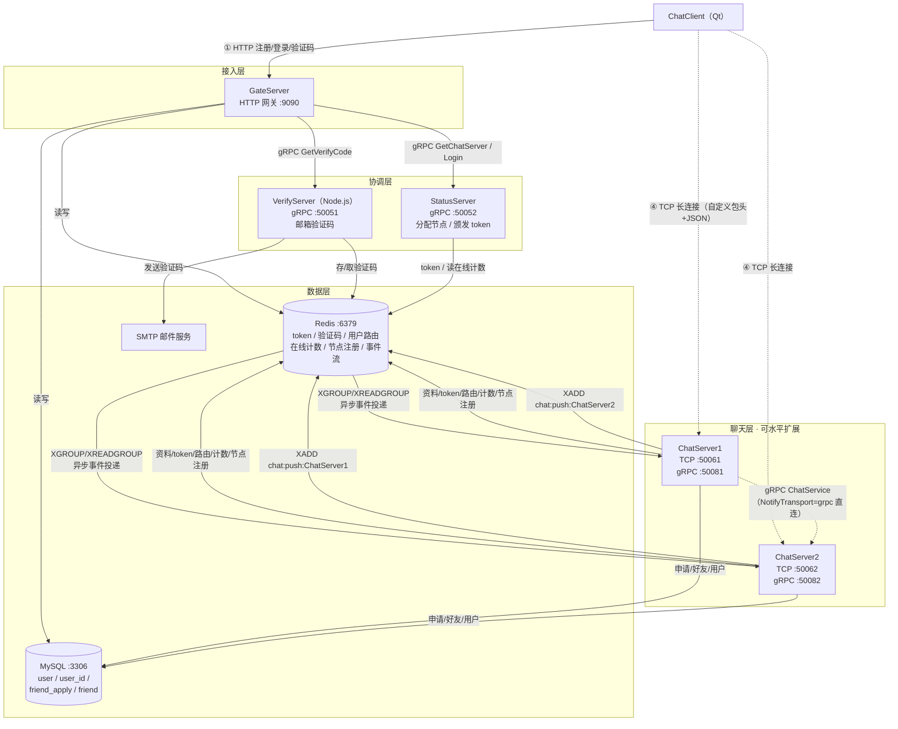

# Chat 服务端集群

## 简介

即时通讯系统的服务端，包含三个 C++17 业务服务（GateServer / ChatServer / StatusServer）、一个公共静态库 `common` 和一个 Node.js 验证服务（VerifyServer）。基础设施（Redis / MySQL / gRPC 客户端 / proto / 单例 / 常量）统一沉淀到 `common/`（编译为 `libchat_common.a`），业务服务只保留各自独有的 TCP / HTTP / gRPC 实现。

> **本目录是服务端的构建入口。** 仓库根目录没有 `CMakeLists.txt`，所有构建命令都在 `Servers/` 下执行。Qt 客户端代码位于同级目录 [../Client](../Client/README.md)。

### 核心特性

- **用户认证**：注册、登录、密码重置（邮箱验证码）
- **负载均衡接入**：StatusServer 按在线人数把新连接分配给最空闲的 ChatServer
- **分布式聊天节点**：ChatServer 可水平扩展，通过 Redis 节点注册表动态发现对端；跨节点通知默认写入目标的 `chat:push:{node}` Stream，由 consumer group 异步投递，gRPC 保留为显式直连通道
- **好友系统**：搜索用户、申请、同意/拒绝（`action=1/2`），拒绝后重新申请自动复位
- **持久化与缓存**：MySQL 存用户与好友关系；Redis 存验证码 / token / 用户资料 / 路由 / 在线计数
- **顶号**：重复登录不拒绝，自动踢掉旧会话

### 技术栈

| 组件 | 技术 |
|---|---|
| 客户端 | Qt 6, C++17 |
| 服务端 | C++17, gRPC, Boost.Asio, MySQL, Redis |
| 公共库 | C++17 静态库 `chat_common`（含 gRPC/Boost/hiredis/redis++/mysqlcppconn/jsoncpp） |
| 验证服务 | Node.js, gRPC, ioredis, nodemailer |

---

## 系统架构



**三个 C++ server 都依赖 `libchat_common.a`**，公共代码通过 `target_link_libraries(... chat_common)` 传递。

### 端口一览

| 服务 | 协议 | 端口 | 说明 |
|---|---|---|---|
| GateServer | HTTP | 9090 | 客户端注册/登录/验证码入口 |
| VerifyServer | gRPC | 50051 | `VerifyService.GetVerifyCode` |
| StatusServer | gRPC | 50052 | `StatusService.GetChatServer / Login` |
| ChatServer1 | TCP / gRPC | 50061 / 50081 | 聊天节点 1（客户端口 / 节点间口） |
| ChatServer2 | TCP / gRPC | 50062 / 50082 | 聊天节点 2 |

---

## 项目结构

```
chat/
├── CMakeLists.txt                 # 顶层 CMake（add_subdirectory: common → 3 servers → tests）
├── tests/                         # CTest 单元测试（零框架依赖，默认启用，见 AGENTS.md#测试）
│
├── common/                        # 公共静态库 libchat_common.a
│   ├── CMakeLists.txt             # 定义静态库 + proto 自动生成
│   ├── include/chat/              # 公共头文件（用 #include "chat/xxx.h" 引用）
│   │   ├── noncopyable.h          #   - DISALLOW_COPY_MOVE 宏
│   │   ├── constants.h            #   - Defer / ErrorCodes / MSG_IDS / 申请状态与 action 常量
│   │   ├── log.h                  #   - 统一日志宏 LOG_DEBUG/INFO/WARN/ERROR
│   │   ├── config_manager.h       #   - INI 配置解析
│   │   ├── redis_manager.h        #   - Redis 连接池
│   │   ├── mysql_dao.h            #   - MySQL DAO + 连接池
│   │   ├── mysql_manager.h        #   - MySQL 管理器
│   │   ├── rpc_stub_pool.h        #   - gRPC stub 连接池模板
│   │   ├── asio_io_context_pool.h #   - Asio I/O 线程池
│   │   ├── password_crypto.h      #   - 口令摘要 SHA-256(固定盐) + 恒定时间比较
│   │   ├── service_interfaces.h   #   - 基础设施接口层（IUserStore/IKeyValueStore/IVerifyCodeService/IChatServerRouter）
│   │   ├── session_registry.h     #   - uid → 会话注册表模板（纯逻辑，可单测）
│   │   ├── status_grpc_client.h   #   - StatusServer gRPC 客户端
│   │   └── verify_grpc_client.h   #   - VerifyServer gRPC 客户端
│   ├── src/                       # 公共实现
│   └── proto/message.proto        # 唯一 proto 源（生成至 build/common/grpc_gen/）
│
├── ChatServer/                    # TCP 聊天服务（业务层，可多实例）
│   ├── main.cpp / config.ini / config2.ini
│   └── src/
│       ├── cserver.h/cpp          #   - TCP server，session 生命周期
│       ├── csession.h/cpp         #   - 连接会话，包头/JSON 读写
│       ├── msg_node.h/cpp         #   - 消息节点
│       ├── user_manager.h/cpp     #   - uid → session 映射（用 SessionRegistry）
│       ├── logic_system.h/cpp     #   - 登录/搜人/好友申请/认证
│       ├── chat_flow.h/cpp        #   - 可单测的纯业务函数（搜人/登录/加好友/认证/文本消息）
│       ├── chat_message_router.h/cpp # - 跨节点通知统一出口（Stream / gRPC）
│       ├── chat_event_bus.h/cpp      # - Redis Stream 发布端
│       ├── chat_event_consumer.h/cpp # - consumer group、ACK、重试、死信
│       ├── chat_notifier.h/cpp       # - 通知落地的共用逻辑
│       ├── chat_grpc_client.h/cpp    # - gRPC 直连通道与节点发现
│       └── chat_service_impl.h/cpp   # - 处理其他 ChatServer 的 gRPC 通知
│
├── GateServer/                    # HTTP 网关服务（业务层）
│   ├── main.cpp / config.ini
│   └── src/
│       ├── cserver.h/cpp          #   - HTTP server
│       ├── http_connection.h/cpp  #   - HTTP 连接与请求分发
│       ├── http_params.h/cpp      #   - URL 解码 / 查询串解析（纯函数）
│       ├── gate_flow.h/cpp        #   - 可单测的纯业务函数（注册/登录/重置/验证码）
│       └── logic_system.h/cpp     #   - 注册/登录/重置/验证码 Handler（薄壳）
│
├── StatusServer/                  # gRPC 状态/协调服务（业务层）
│   ├── main.cpp / config.ini
│   └── src/
│       ├── status_service_impl.h/cpp  # 节点分配、token 颁发、负载刷新
│       ├── server_select.h/cpp        # 选点纯函数 PickMinServer（最小在线数）
│       └── status_flow.h/cpp          # token 生成 / 写入 / 校验纯函数
│
├── VerifyServer/                  # Node.js 邮件验证服务（gRPC :50051）
│
├── build/                         # 统一构建目录
├── logs/                          # 各服务运行日志
├── start.sh / status.sh / stop.sh # 服务管理脚本
└── 文档：README.md / AGENTS.md / REFACTORING.md / DEPLOY.md
```

---

## 快速开始

> 完整部署流程（依赖安装、数据库初始化、冒烟验证、systemd）见 [DEPLOY.md](DEPLOY.md)。

```bash
# 依赖（Ubuntu 22.04；gRPC/Protobuf、redis++ 需按官方文档源码安装）
sudo apt install -y build-essential cmake ninja-build pkg-config libssl-dev zlib1g-dev \
    mysql-server redis-server libmysqlcppconn-dev libhiredis-dev libjsoncpp-dev libboost-all-dev

cd Servers                        # ⚠️ 入口是 Servers/，不是仓库根目录
cmake -S . -B build -G Ninja
cmake --build build -j$(nproc)

./start.sh    # Redis → VerifyServer → GateServer → ChatServer1/2 → StatusServer
./status.sh   # 查看状态
./stop.sh     # 反序停止
```

环境要求：CMake **3.20+**、GCC 12+（C++17）、Node.js 14+、MySQL 5.7+、Redis 5.0+、Boost 1.74+。

---

## 单元测试

不需要 MySQL / Redis / 网络即可运行（业务逻辑已与基础设施解耦，测试注入内存 fake）。

```bash
cd Servers
cmake -S . -B build -G Ninja      # 默认启用测试；-DBUILD_TESTING=OFF 关闭
cmake --build build -j1           # ⚠️ 单线程编译，避免内存/CPU 打满
ctest --test-dir build --output-on-failure

cd VerifyServer && npm install && npm test   # Node.js 侧，用内置 test runner
```

| 测试 | 被测模块 | 用例数 | 覆盖要点 |
|---|---|---|---|
| `test_password_crypto` | `common/src/password_crypto.cpp` | 6 | 口令摘要确定性/定长/雪崩、恒定时间比较 |
| `test_msg_node` | `ChatServer/src/msg_node.cpp` | 4 | 裸缓冲构造 / 截断 / 读写 |
| `test_protocol_constants` | `common/include/chat/constants.h` | 3 | `MSG_IDS` / `ErrorCodes` 数值契约 |
| `test_config_manager` | `common/src/config_manager.cpp` | 2 | INI 解析与默认值回退 |
| `test_gate_flow` | `GateServer/src/gate_flow.cpp` | 12 | 验证码 / 注册 / 重置 / 登录成功与失败分支 |
| `test_chat_flow` | `ChatServer/src/chat_flow.cpp` | 46 | 搜人、资料加载（缓存+回落）、登录、加好友、认证、文本消息、跨节点通知 JSON |
| `test_server_select` | `StatusServer/src/server_select.cpp` | 8 | 最小在线数选点、缺计数默认值、脏计数容错 |
| `test_status_flow` | `StatusServer/src/status_flow.cpp` | 9 | token 生成 / TTL 写入 / 一次性消费校验 |
| `test_msg_codec` | `ChatServer/src/msg_codec.cpp` | 7 | TCP 帧头大端字节序（与客户端 QDataStream 对齐） |
| `test_http_params` | `GateServer/src/http_params.cpp` | 8 | URL 解码（含畸形转义）、查询串解析 |
| `test_session_registry` | `common/include/chat/session_registry.h` | 7 | uid→会话绑定、顶号语义（旧会话不得删新绑定） |
| `test_node_info` | `common/src/node_info.cpp` | 6 | 节点注册信息编解码、旧字段兼容、endpoint 拼接 |
| `test_rpc_dispatch` | `ChatServer/src/rpc_dispatcher` | 3 | 固定 key 落同一 worker、队列上限、停止语义 |
| `test_business_worker` | `ChatServer/src/business_worker.h` | 3 | 同一 session 固定分片、worker 数为 0/1 的退化边界 |
| `test_chat_event` | `ChatServer/src/chat_event.cpp` | 2 | 跨节点事件类型名称与解析的往返/非法值 |
| `VerifyServer/test` | `verify-code.js` / `constants.js` / 配置模板 | 8 | 验证码逻辑、**错误码与 C++ 逐项同值**、配置模板自检 |

合计 **15 个 C++ 测试（126 用例）+ 3 个 Node 测试文件**。

> 尚未覆盖的是纯 I/O 层：`mysql_dao` / `redis_manager` / `chat_event_bus` / `chat_event_consumer` / `csession` 收发 / gRPC 客户端，
> 需要真实依赖或容器化环境。新增用例的方式见 [AGENTS.md](AGENTS.md#测试)。

---

## 接口与协议

### HTTP 接口（GateServer :9090）

| 路径 | 方法 | 说明 |
|---|---|---|
| `/getVerifyCode` | POST | 获取邮箱验证码（gRPC 调 VerifyServer） |
| `/registerUser` | POST | 注册新用户 |
| `/resetPassword` | POST | 重置密码 |
| `/userLogin` | POST | 登录，返回 ChatServer 的 host/port 与 token |

### gRPC 接口（common/proto/message.proto）

```protobuf
service VerifyService { rpc GetVerifyCode(GetVerifyReq) returns (GetVerifyRsp); }

service StatusService {
  rpc GetChatServer(GetChatServerReq) returns (GetChatServerRsp);  // 分配节点 + 颁发 token
  rpc Login(LoginReq) returns (LoginRsp);                          // 校验并一次性消费 token
}

service ChatService {  // ChatServer 节点间直连通道（NotifyTransport=grpc）
  rpc NotifyAddFriend(AddFriendReq) returns (AddFriendRsp);
  rpc ReplyFriend(ReplyFriendReq) returns (ReplyFriendRsp);         // 已定义，暂无调用
  rpc SendChatMsg(SendChatMsgReq) returns (SendChatMsgRsp);         // 已定义，暂无调用
  rpc NotifyFriendAccepted(FriendAcceptedReq) returns (FriendAcceptedRsp); // action: 1同意 2拒绝
  rpc NotifyTextChatMsg(TextChatMsgReq) returns (TextChatMsgRsp);
  rpc NotifyKickUser(KickUserReq) returns (KickUserRsp);            // 顶号踢下线
}
```

### 错误码（ErrorCodes）

服务端与客户端共享的整数契约，定义在 `common/include/chat/constants.h`：

| 值 | 枚举 | 含义 |
|---|---|---|
| 0 | SUCCESS | 成功 |
| 1 | ERROR_JSON | JSON 解析/字段/action 非法 |
| 2 | RPC_FAILED | gRPC 调用失败 |
| 3 | VERIFYCODE_NOT_FOUND_OR_EXPIRED | 验证码不存在或过期 |
| 4 | USER_EXIST | 用户/邮箱已存在 |
| 5 | EMAIL_NOT_MATCH | 重置密码时姓名邮箱不匹配 |
| 6 | UPDATE_PASSWORD_FAILED | 更新密码失败 |
| 7 | PASSWORD_NOT_MATCH | 密码错误 |
| 8 | UID_INVALID | 用户不存在/资料拉取失败 |
| 9 | TOKEN_INVALID | token 无效 |
| 10 | USER_ALREADY_LOGIN | 保留值，现不使用（已改为顶号模式） |
| 20001 | VERIFY_CODE_EXISTS | VerifyServer：该邮箱 10 分钟内已有有效验证码 |
| 20002 | VERIFY_REDIS_ERROR | VerifyServer：验证码写入 Redis 失败 |
| 20003 | VERIFY_MAIL_FAILED | VerifyServer：验证码邮件发送失败 |

> `20001+` 为 **VerifyServer 预留段**：`/getVerifyCode` 的错误码由 VerifyServer（Node.js）产生，已收敛进本表并避开通用码（0~10）；GateServer 原样透传、不做翻译。详见 [VerifyServer/README.md](VerifyServer/README.md#错误码)。

### 一次完整登录

客户端 `POST /userLogin` → GateServer 校验密码 → StatusServer 选出节点并颁发 token → 客户端与该 ChatServer 建立 TCP 长连接 → ChatServer 经 gRPC 调 StatusServer 完成 token 二次校验。各流程的详细时序图见下方文档索引。

> TCP 消息号（`MSG_IDS`）与字段语义见 [common/README.md](common/README.md) 与 [ChatServer/README.md](ChatServer/README.md#消息协议)。

---

## 故障排除

| 现象 | 排查 |
|---|---|
| `cmake: no such file or directory: CMakeLists.txt` | 你不在 `Servers/` 目录。根目录没有 CMakeLists |
| CMake 报版本过低（要求 3.20） | `cmake --version` 确认 ≥ 3.20；Ubuntu 20.04 自带过低需升级 |
| 编译找不到 `chat/xxx.h` | 确认在 `Servers/` 下构建，重新 `cmake -S . -B build -G Ninja` |
| MySQL 连接失败 / 2014 Commands out of sync | 核对 `config.ini` 的 `[MySQL]`；连接池已修复（健康检查消费结果集、异常连接丢弃），确认用最新代码 |
| 注册报错 / uid 异常 | 检查是否漏建 `user_id` 发号器表 |
| Redis 连接失败 | `redis-cli ping`；核对 `config.ini` 的 `[Redis]` |
| gRPC 连不上 | `pgrep -f "node.*server.js"`；看 `logs/` 下对应日志 |
| 跨服通知延迟/丢失 | `redis-cli XLEN chat:push:{节点名}`、`XINFO GROUPS chat:push:{节点名}` 看 lag/pending；必要时把 `NotifyTransport` 临时切到 `grpc` |
| 跨服事件反复重试 | `redis-cli XPENDING chat:push:{节点名}` 查看 pending；检查 `chat:dead:{节点名}` 与消费端日志 |
| 登录成功但客户端连不上聊天节点 | `StatusServer/config.ini` 里的 ChatServer Host 不可达（本地部署需改成 `127.0.0.1`） |
| 端口占用 | 9090 / 50051 / 50052 / 50061 / 50062 / 50081 / 50082 |
| 配置加载失败 | 可执行文件与 `config.ini` 必须同目录（`build/<server>/`） |

日志统一格式 `[时间戳(毫秒)] [级别] 内容`，位于 `logs/`。更多部署排查见 [DEPLOY.md](DEPLOY.md)。

---

## 安全提示

以下问题在源码中真实存在，**上线前必须处理**：

| 问题 | 位置 | 建议 |
|---|---|---|
| 数据库账号密码明文 | 各 `config.ini` 的 `[MySQL]` | 改用环境变量或密文注入，配置不入库 |
| 邮箱 SMTP 授权码明文 | `VerifyServer/config.json` | 立即轮换，改用环境变量注入 |
| 密码存储 | GateServer + MySQL | 已改为固定盐 SHA-256 摘要入库（见 common/include/chat/password_crypto.h），响应体不含 pwd，比对走 `ConstantTimeEquals`（`CRYPTO_memcmp`）恒定时间比较；建议后续升级为 bcrypt / argon2id + 逐用户随机盐 |
| 无 gRPC 鉴权 | 各服务间 gRPC | 内网部署 + mTLS，或加服务间 token |
| 无 TLS | GateServer HTTP | 前置 Nginx 终止 TLS |

---

## 文档索引

| 文档 | 说明 |
|---|---|
| [AGENTS.md](AGENTS.md) | 面向 AI Agent 的项目指引（构建/约定/约束） |
| [DEPLOY.md](DEPLOY.md) | 部署与运维：依赖、数据库、构建、冒烟、systemd |
| [REFACTORING.md](REFACTORING.md) | 三 Server 解耦的设计决策与权衡 |
| [CLUSTER_COMMUNICATION.md](CLUSTER_COMMUNICATION.md) | 多 ChatServer 通信改造前后对比、架构、可靠性与运维 |
| [common/README.md](common/README.md) | 公共静态库：组件、proto 契约、Redis 键约定、基础设施行为 |
| [GateServer/README.md](GateServer/README.md) | HTTP 网关：流程图、注册/验证码/重置/登录时序 |
| [ChatServer/README.md](ChatServer/README.md) | TCP 聊天节点：流程图、登录校验、好友/聊天时序与状态机、消息协议 |
| [StatusServer/README.md](StatusServer/README.md) | 协调服务：负载刷新流程图、token 校验时序 |
| [VerifyServer/README.md](VerifyServer/README.md) | Node.js 验证服务：GetVerifyCode 流程、SMTP 重试、错误码 |
