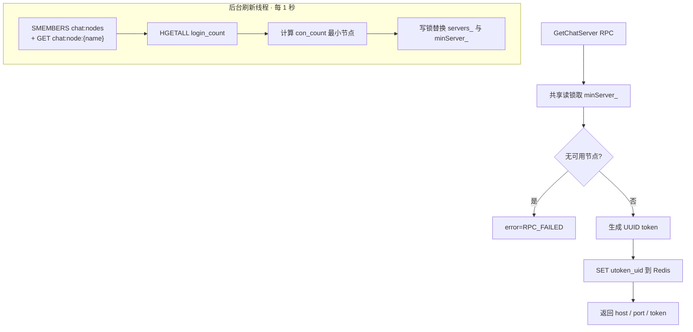
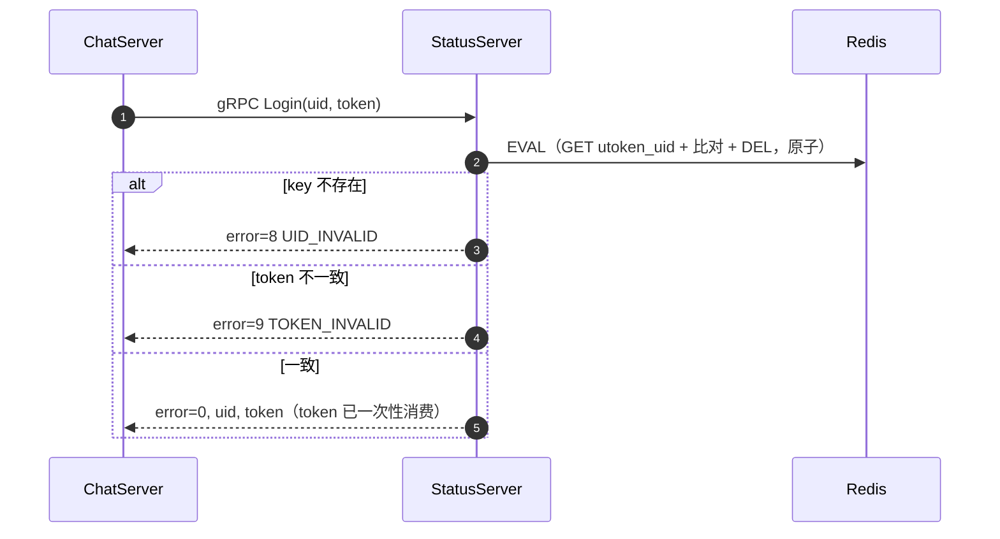

# StatusServer

## 简介

系统的 **gRPC 协调服务**（默认 :50052），提供两个能力：

- **GetChatServer**：按各 ChatServer 的在线连接数（Redis Hash `login_count`）选出负载最低的节点，返回其 host/port，并生成 UUID token 写入 Redis（`utoken_{uid}`）
- **Login**：校验 uid + token 是否有效（由 ChatServer 的 TCP 登录流程调用）

节点列表只来自 Redis 注册表（`chat:nodes` / `chat:node:{name}`，由 ChatServer 启动时写入并心跳续期）；后台线程每 1 秒刷新一次最小负载节点缓存，RPC 请求只做短时间持锁的内存读取，不被 Redis IO 阻塞。

## gRPC 接口

```protobuf
service StatusService {
  rpc GetChatServer(GetChatServerReq) returns (GetChatServerRsp); // 分配节点 + 颁发 token
  rpc Login(LoginReq) returns (LoginRsp);                         // token 校验
}
```

## 内部流程：后台负载刷新 + 请求分配



> 刷新失败（Redis 异常、配置为空）时保留上一轮缓存，不用空数据覆盖；`login_count` 脏值由 `std::from_chars` 安全解析并按缺省负载处理，单条坏数据不会拖垮整轮刷新。

## Token 校验流程（Login）



> **token 一次性消费**：`GetChatServer` 写入 `utoken_{uid}`（TTL 600 秒）后，无论由 ChatServer 直连 Redis 校验，还是调用本 RPC，都会通过 Lua 原子完成 `GET + 比对 + DEL`。同一 token 在 TTL 内不能重放。
>
> 当前 TCP 登录链路由 ChatServer 直连 Redis 消费 token（见 `ChatServer/src/chat_flow.cpp` 的 `ProcessLogin`），未调用本 RPC；`StatusService.Login` 保留给需要显式 gRPC 校验的控制面调用，语义同样是「校验并消费」。

## 并发模型

- `servers_ / minServer_` 由 `std::shared_mutex` 保护：后台刷新偶尔写，RPC 高频读
- 刷新线程通过 `running_` 标志 + 100ms 小步睡眠支持快速退出，析构时 `join`
- UUID 生成器使用 `thread_local`，避免多线程竞争

## 配置

```ini
[StatusServer]
Host = 127.0.0.1
Port = 50052
```

节点列表只来自 Redis 注册表，不再需要 `[ChatServers]` / `[ChatServerN]`。下发到客户端的地址取自 ChatServer 注册的 `PublicHost:tcpPort`，因此必须在 ChatServer 的 `[SelfServer]` 中填写客户端可达的 `PublicHost`。

## 开发者注意

- 新增 ChatServer 节点：启动时自动注册到 Redis，StatusServer 自动发现；无需修改 StatusServer 或其他 ChatServer 配置。
- 注册表不可用时 StatusServer 保留上一轮节点缓存；进程首次启动时若注册表为空，会返回 `RPC_FAILED`，待 ChatServer 注册并完成下一轮刷新后恢复。
- 单线程编译验证：`cmake --build build --target statusServer -j1`

---

## 单元测试

```bash
cd Servers && cmake --build build -j1 && ctest --test-dir build -R 'test_(server_select|status_flow)' --output-on-failure
```

- `test_server_select`（8 用例）：`PickMinServer` 选最小在线数、缺计数按 `INT_MAX>>1`、空快照返回默认节点、计数按数值比较、脏计数不抛异常。
- `test_status_flow`（9 用例）：token 生成（UUID 形态/唯一）、写入带 TTL、校验（缺失/不匹配/成功/按 uid 隔离/空 token 不放行/一次性消费不可重放）。

> 选点与 token 逻辑都抽成了纯函数（`server_select.*` / `status_flow.*`），依赖通过 `IKeyValueStore` 注入，
> 因此单测不需要起 Redis。
