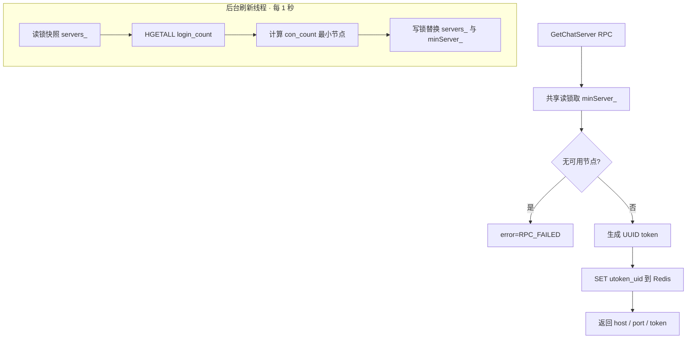
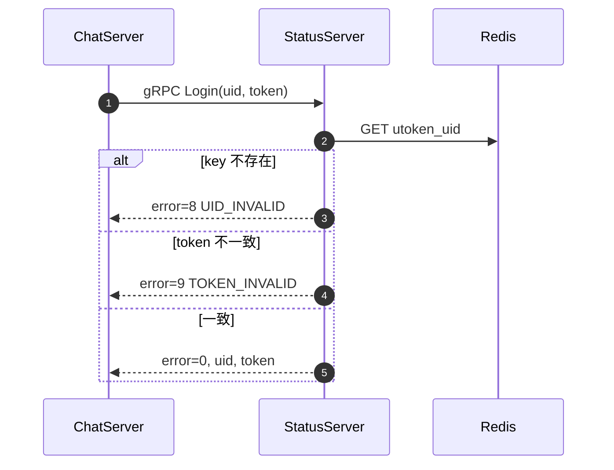

# StatusServer

## 简介

系统的 **gRPC 协调服务**（默认 :50052），提供两个能力：

- **GetChatServer**：按各 ChatServer 的在线连接数（Redis Hash `login_count`）选出负载最低的节点，返回其 host/port，并生成 UUID token 写入 Redis（`utoken_{uid}`）
- **Login**：校验 uid + token 是否有效（由 ChatServer 的 TCP 登录流程调用）

节点列表来自 `config.ini` 的 `[ChatServers]`；后台线程每 1 秒刷新一次最小负载节点缓存，RPC 请求只做短时间持锁的内存读取，不被 Redis IO 阻塞。

## gRPC 接口

```protobuf
service StatusService {
  rpc GetChatServer(GetChatServerReq) returns (GetChatServerRsp); // 分配节点 + 颁发 token
  rpc Login(LoginReq) returns (LoginRsp);                         // token 校验
}
```

## 内部流程：后台负载刷新 + 请求分配



> 刷新失败（Redis 异常、配置为空）时保留上一轮缓存，不用空数据覆盖；`stoi` 等异常由外层 catch 兜住，刷新线程不会中断。

## Token 校验流程（Login）



> ⚠️ **现状**：当前 TCP 登录链路里 ChatServer 是**直连 Redis** 读 `utoken_{uid}` 校验的
> （见 `ChatServer/src/chat_flow.cpp` 的 `ProcessLogin`），并未调用本 RPC；
> 且校验后**不删除** token，靠 600 秒 TTL 自然过期（重放窗口 = TTL）。
> 本 RPC 已实现且有单测（`tests/test_status_flow.cpp`），接入与否不影响现有链路。

> **token 生命周期**：`GetChatServer` 时由 `StoreLoginToken` 写入 `utoken_{uid}`（TTL `LOGIN_TOKEN_TTL_SECONDS = 600`）
> → ChatServer TCP 登录读该键校验 → 无人主动删除，到期自动失效。刷新失败（Redis 异常、节点表为空）时保留上一轮缓存。
>
> ⚠️ 若 ChatServer 进程异常退出未及清理，旧 token 会残留在 Redis 中（此时 GateServer 侧防重复登录也会受影响，需人工 `DEL`）。**建议给 `utoken_{uid}` 加 TTL**。

## 并发模型

- `servers_ / minServer_` 由 `std::shared_mutex` 保护：后台刷新偶尔写，RPC 高频读
- 刷新线程通过 `running_` 标志 + 100ms 小步睡眠支持快速退出，析构时 `join`
- UUID 生成器使用 `thread_local`，避免多线程竞争

## 配置

```ini
[StatusServer]
Host = 127.0.0.1
Port = 50052

[ChatServers]
Name = ChatServer1,ChatServer2      # 逗号分隔的节点名列表

[ChatServer1]
Name = ChatServer1
Host = 127.0.0.1                    # ⚠️ 默认配置里可能写成公网 IP
Port = 50061

[ChatServer2]
Name = ChatServer2
Host = 127.0.0.1
Port = 50062
```

> ⚠️ 这里的 `Host` 是**下发到客户端的连接地址**，必须是客户端能访问到的地址（本地调试 `127.0.0.1`、内网用内网 IP、公网用公网 IP/域名）。填错的表现是：HTTP 登录成功但客户端 TCP 连不上聊天节点。

## 开发者注意

- 新增 ChatServer 节点：在 `config.ini` 的 `[ChatServers] Name=...` 登记并添加对应 section；同时在各 ChatServer 的 `[PeerServer]` / `[ChatServerN]` 补齐对端信息
- 单线程编译验证：`cmake --build build --target statusServer -j1`

---

## 单元测试

```bash
cd Servers && cmake --build build -j1 && ctest --test-dir build -R 'test_(server_select|status_flow)' --output-on-failure
```

- `test_server_select`（7 用例）：`PickMinServer` 选最小在线数、缺计数按 `INT_MAX>>1`、空快照返回默认节点、计数按数值比较。
- `test_status_flow`（8 用例）：token 生成（UUID 形态/唯一）、写入带 TTL、校验（缺失/不匹配/成功/按 uid 隔离/空 token 不放行）。

> 选点与 token 逻辑都抽成了纯函数（`server_select.*` / `status_flow.*`），依赖通过 `IKeyValueStore` 注入，
> 因此单测不需要起 Redis。
