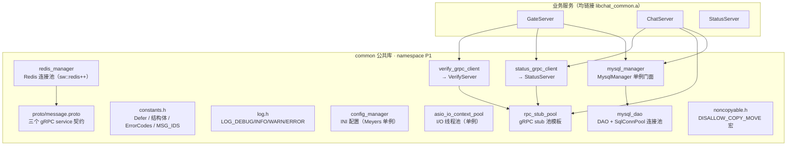

# common 公共静态库

## 简介

`common` 编译为静态库 **`libchat_common.a`**，是 GateServer / ChatServer / StatusServer 三个 C++ 服务共享的基础设施层。业务服务通过 `target_link_libraries(<server> PRIVATE chat_common)` 链接本库，所有外部依赖（gRPC、Boost、hiredis、redis++、mysqlcppconn、jsoncpp、OpenSSL）以 `PUBLIC` 方式自动向下传递，业务服务自身不再写依赖查找。

设计动机与解耦过程详见 [../REFACTORING.md](../REFACTORING.md)。

## 组件架构



## 目录与文件清单

| 文件 | 说明 |
|---|---|
| [CMakeLists.txt](../common/CMakeLists.txt) | 定义 `chat_common` 静态库；protoc/grpc_cpp_plugin 自动生成代码到 `build/common/grpc_gen/` |
| [proto/message.proto](../common/proto/message.proto) | 全局唯一 proto 源，定义全部 gRPC 接口与消息 |
| `include/chat/noncopyable.h` | `DISALLOW_COPY_MOVE(ClassName)` 宏，禁用拷贝与移动 |
| [include/chat/log.h](../common/include/chat/log.h) | 统一日志宏 |
| [include/chat/constants.h](../common/include/chat/constants.h) | `Defer`、`UserInfo`/`ApplyInfo`、Redis key 前缀、状态/动作常量、`ErrorCodes`、`MSG_IDS` |
| `include/chat/config_manager.h` / `src/config_manager.cpp` | INI 配置解析单例 |
| `include/chat/asio_io_context_pool.h` / `src/asio_io_context_pool.cpp` | Asio io_context 线程池单例 |
| `include/chat/redis_manager.h` / `src/redis_manager.cpp` | Redis 连接池单例 |
| `include/chat/mysql_dao.h` / `src/mysql_dao.cpp` | MySQL DAO 与内部连接池 |
| `include/chat/mysql_manager.h` / `src/mysql_manager.cpp` | MySQL 管理器单例 `MysqlManager`（包装 `MysqlDao`） |
| `include/chat/service_interfaces.h` | 基础设施接口层：`IUserStore` / `IKeyValueStore` / `IVerifyCodeService` / `IChatServerRouter`（业务与 DB/Redis/gRPC 解耦，单测注入 fake） |
| `include/chat/session_registry.h` | `SessionRegistry<SessionPtr>`：uid → 会话指针的线程安全注册表模板（含顶号语义，有单测） |
| `include/chat/node_info.h` / `src/node_info.cpp` | ChatServer 节点注册信息编解码（纯逻辑，有单测） |
| `include/chat/node_registry.h` / `src/node_registry.cpp` | Redis 节点注册表读写、TTL 心跳与 RAII 注册器 |
| `include/chat/password_crypto.h` / `src/password_crypto.cpp` | 口令摘要 `HashPassword`（固定盐 SHA-256）与恒定时间比较 `ConstantTimeEquals` |
| `include/chat/rpc_stub_pool.h` | gRPC stub 连接池类模板（header-only） |
| `include/chat/status_grpc_client.h` / `src/status_grpc_client.cpp` | StatusServer gRPC 客户端单例 |
| `include/chat/verify_grpc_client.h` / `src/verify_grpc_client.cpp` | VerifyServer gRPC 客户端单例 |

> 公共库所有符号位于命名空间 **`P1`**；头文件统一以 `#include "chat/xxx.h"` 引用。

## gRPC 协议契约

唯一 proto 源为 [proto/message.proto](../common/proto/message.proto)，定义三个 service：`VerifyService`（邮箱验证码）、`StatusService`（分配节点 + 颁发 token、token 校验）、`ChatService`（ChatServer 节点间：好友通知、文本消息转发、踢下线）。接口一览见 [../README.md](../README.md#grpc-接口commonprotomessageproto)。

`ChatService` 中 `ReplyFriend` / `SendChatMsg` 已定义但暂无调用，其余均已实现。

## 常量与协议号（constants.h）

### Redis 键约定

| 前缀 / 键 | 含义 | 写入方 |
|---|---|---|
| `utoken_{uid}` | 本次登录的 token（TTL 600 秒） | StatusServer 颁发；ChatServer 登录时在同一段 Lua 中比对并删除，一次性消费 |
| `uinfo_{uid}` | 用户资料 JSON 缓存 | ChatServer（miss 回源 MySQL 并回填），退出删除 |
| `userver_{uid}` | 用户所在 ChatServer 节点名（跨服路由依据） | ChatServer 登录写入，退出时校验后删除 |
| Hash `login_count` | 各节点在线连接计数 | ChatServer 登录 +1、退出 -1、进程退出 HDel 节点 |
| Set `chat:nodes` | 当前存活 ChatServer 节点名集合 | ChatServer 启动 SADD、退出 SREM；StatusServer 读取并清理过期成员 |
| String `chat:node:{name}` | 节点注册信息 JSON（rpc/public 地址与端口），TTL 30 秒 | ChatServer 启动写入、每 10 秒心跳续期 |
| Stream `chat:push:{name}` | 目标 ChatServer 的跨节点事件流（`type/payload/source/event_id/created_ms`） | 任意 ChatServer 发布；目标节点 consumer group 消费 |
| Stream `chat:dead:{name}` | 目标节点的死信流（超过最大投递次数或 payload 非法） | 目标节点消费端写入，保留最近 1 万条 |
| String `chat:dedup:{name}:{streamId}` | Stream 消费幂等键，默认 TTL 600 秒 | 目标节点消费成功后 `SET NX EX` 写入 |

> 验证码 key `code_{email}` 由 Node.js VerifyServer 写入（TTL 600 秒），仅 GateServer 读取，故前缀常量只定义在 GateServer 与 VerifyServer 中。
>
> ⚠️ **`userver_{uid}` 目前不设 TTL**：进程异常退出未清理时会残留，跨服路由可能短暂指向已下线节点（消息按"用户不在线"丢弃，无实质影响）；残留键会在下次登录时被顶号流程覆盖，实现自愈。彻底治理建议加 TTL 并由心跳续期。

### 好友申请状态 / 认证动作

- `friend_apply.status`：`APPLY_STATUS_PENDING=0`（待处理）、`APPLY_STATUS_ACCEPTED=1`（同意）、`APPLY_STATUS_REJECTED=2`（拒绝）
- `AUTH_FRIEND_REQ.action`：`FRIEND_ACTION_ACCEPT=1`、`FRIEND_ACTION_REJECT=2`

### ErrorCodes

C++ 服务间及服务端与客户端共享的整数契约，完整表见 [../README.md](../README.md#错误码errorcodes)。

### MSG_IDS（ChatServer TCP 消息号）

`10001~10016` 为业务消息：

| 消息号 | 含义 |
|---|---|
| 10001 / 10002 | 登录请求 / 响应 |
| 10003 / 10004 | 搜索用户请求 / 响应 |
| 10005 / 10006 | 加好友请求 / 响应 |
| 10007 / 10008 | 加好友通知 / 响应 |
| 10009 / 10010 | 好友认证请求 / 响应 |
| 10011 / 10012 | 认证通知 / 响应 |
| 10013 / 10014 | 文本聊天请求 / 响应 |
| 10015 / 10016 | 文本聊天通知 / 响应 |
| 99999 | 心跳包 |

完整字段语义见 [../ChatServer/README.md](../ChatServer/README.md#消息协议)。

## 基础设施行为约定

### 日志（log.h）

- 宏：`LOG_DEBUG / LOG_INFO / LOG_WARN / LOG_ERROR`，printf 风格可变参数
- 格式：`[yyyy-mm-dd hh:mm:ss.mmm] [LEVEL] message`，全局互斥锁保证多线程安全，输出到 stderr（由 `nohup` 重定向至 `logs/`）
- **全项目禁止 `std::cout / std::cerr / printf` 直接输出**

### 配置（config_manager）

- Meyers 单例；`Init()` 默认读 `./config.ini`，也可 `Init(path)` 指定（ChatServer 用 `config.ini` / `config2.ini` 起多实例）
- 取值模板 `GetValue<T>(section, key, default)`，基于 boost::lexical_cast 转换
- 依赖"可执行文件与 config.ini 同目录"，故各 server 产物分别落在 `build/<server>/`

### I/O 线程池（asio_io_context_pool）

- Meyers 单例，默认 2 个 io_context 线程；`GetIOService()` 按 round-robin 分配，下标 `nextIOContext_` 为 `std::atomic`
- 每个 io_context 用 `work_guard` 保活；`Stop()` 顺序：reset work_guard → io_context.stop() → join

### Redis（redis_manager）

- `RedisManagerPool` 单例，封装 sw::redis++；默认 socket_timeout 200ms、connect_timeout 500ms、连接池 5、取连接 wait_timeout 100ms
- 未连接或取连接超时时 `Client()` 返回 nullptr，调用方必须判空；故障期间降频告警避免日志风暴
- 阻塞命令 `XREADGROUP BLOCK` 使用独立单连接（`[Redis] BlockingSocketTimeoutMs`，默认 5000ms）；普通连接保持 200ms socket 超时，避免阻塞读被 `EAGAIN` 打断
- 提供 string / hash / set / list / generic 命令封装，以及 Stream API：`XAdd`、`XGroupCreate`、`XReadGroup`、`XClaim`、`XAck`、`XPending`、`XLen`、`Expire`
- `XGroupCreate` 将 `BUSYGROUP` 视为成功，消费端可安全重试建组；`XAdd` 支持近似裁剪（`MAXLEN ~`）

### MySQL（mysql_dao + mysql_manager）

- 内部类 `SqlConnPool`：`Acquire()` 取连接带 **3 秒超时**，池耗尽返回 nullptr（不永久阻塞）；后台健康检查线程周期性 `SELECT 1`（完整消费结果集），空闲连接按阈值 Reconnect
- DAO 异常 catch 分支对连接执行 `reset()` 丢弃，避免脏连接回池（如 error 2014）
- 主要 DAO 方法：`RegUserTransaction`（事务内 `UPDATE user_id SET id=LAST_INSERT_ID(id+1)` 取号并插入 user）、`CheckEmail` / `UpdatePassword` / `CheckPassword`、`GetUserByUid` / `GetUserByName`、`AddFriendApply`（`ON DUPLICATE KEY UPDATE status=0`）、`AuthFriendApply`（双向 UPDATE）、`AddFriend`（事务内双向 INSERT IGNORE）、`GetApplyList` / `GetFriendList`（JOIN）
- `MysqlManager` 是包装 `dao_` 的单例门面，业务层只接触管理器、不直接引用 `MysqlDao`

### gRPC stub 池（rpc_stub_pool）

- 类模板 `RpcStubPool<ServiceType>`，同一 channel 上预建默认 5 个 stub；stub 本身可并发复用，池用于限制同时在途 RPC 数
- `Acquire(timeout)` 返回 move-only 的 RAII `Lease`，析构自动归还，异常或提前 `return` 不会漏 stub；池耗尽时按超时快速失败并输出 WARN，不再无限阻塞
- `GetStats()` 提供 `created` / `available` / `inUse` / `waiting` / `acquisitions` / `timeouts`，便于观测池耗尽
- channel 默认开启 keepalive（30s ping / 10s 超时），最大重连退避从 gRPC 默认 120s 收紧到 5s
- 池大小与获取超时由 `[RPC] PoolSize`、`[RPC] AcquireTimeoutMs` 配置；StatusServer / VerifyServer 调用同样带 `[RPC] DeadlineMs`
- `status_grpc_client`（默认 127.0.0.1:50052）与 `verify_grpc_client`（默认 127.0.0.1:50051）均为单例

## 构建

公共库不单独产出可执行文件，随顶层项目一起构建：

```bash
cd <repo>/Servers
cmake -S . -B build -G Ninja
cmake --build build -j$(nproc)     # 产物 build/common/libchat_common.a
```

proto 生成物（`message.pb.*` / `message.grpc.pb.*`）位于 `build/common/grpc_gen/`，不进入源码树。
